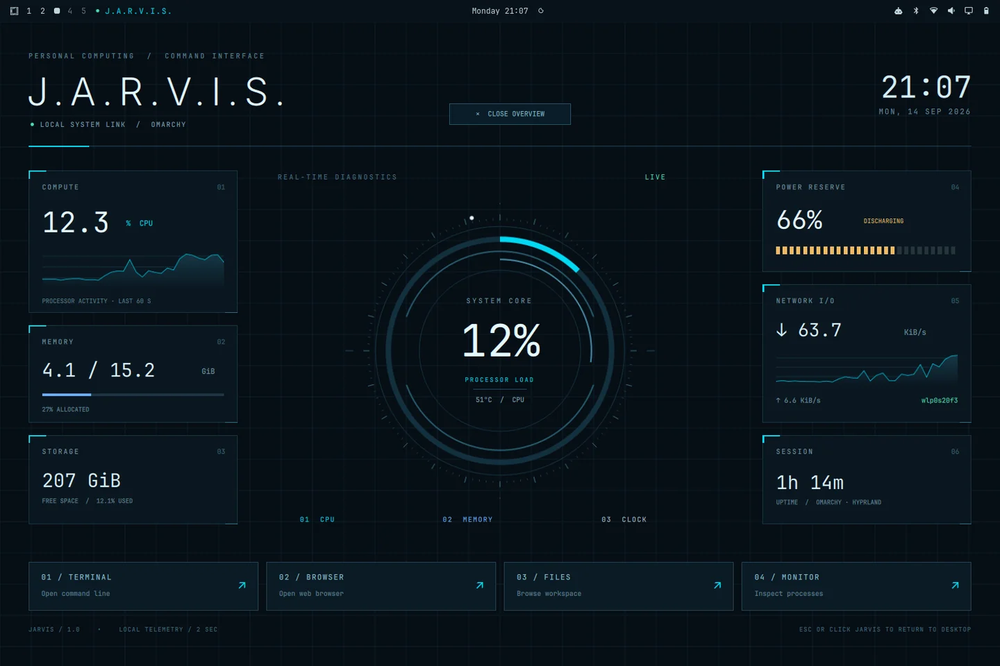

# Jarvis for Omarchy

A dark cyan desktop theme and live command interface for Omarchy 4, styled after a custom Home Assistant Jarvis dashboard.



## Features

- Coordinated colours for the shell, terminals, menus, notifications, and apps supported by Omarchy's theme templates.
- Animated system reactor with counter-rotating rings, a sweeping scan, and a bold live CPU readout.
- Circular memory, storage, and battery gauges, with CPU temperature, network rates, and uptime.
- Locally bundled Orbitron and Rajdhani fonts, a soft radial backdrop, and circular launch controls.
- CPU and network history sampled every two seconds from local Linux counters.
- Command overview with terminal, browser, Files, and btop launchers.
- Jarvis bar button alongside your existing workspaces, AI usage, Wi-Fi, audio, and other controls.
- HUD hides automatically when another theme is selected.

**Tested on Omarchy 4.0.3 with its Quickshell-based shell.** The HUD requires that shell's plugin API and Python 3; it is not a Waybar widget for Omarchy 3. Multi-monitor and other screen sizes have not been tested on hardware. Missing CPU temperature displays a dash. Systems without a battery show external power.

## Install the full interface

Run in your active Omarchy desktop session:

```bash
git clone https://github.com/28labsnz/omarchy-jarvis-theme.git
cd omarchy-jarvis-theme
python3 install.py
```

The installer copies the theme, HUD plugin, and application launcher into your home directory. It enables the plugin, applies Jarvis, and restarts the Omarchy shell to load its QML. It preserves the existing bar layout and visibility setting and backs up affected existing files under `~/.local/state/jarvis/backups/`.

To copy the files without activating anything, use `python3 install.py --no-activate`.

## Install just the colours and wallpaper

```bash
omarchy theme install https://github.com/28labsnz/omarchy-jarvis-theme
```

This uses Omarchy's normal theme installer. It does **not** enable the live HUD. To add the HUD afterwards:

```bash
python3 ~/.config/omarchy/themes/jarvis/install.py
```

## Use

- Open **Jarvis Command Interface** from the app launcher, run `~/.local/bin/jarvis`, or click **J.A.R.V.I.S.** in the bar.
- **Escape** or **Close** dismisses the overview. The HUD stays behind application windows.
- The four buttons open your configured terminal, browser, Files, and btop.
- If the bar is hidden, use your usual Omarchy bar toggle. Jarvis also works from the application launcher.
- The overview takes keyboard focus while open; dismiss it before typing into application windows.

To return to another theme, for example:

```bash
omarchy theme set tokyo-night
```

To disable the HUD entirely:

```bash
omarchy plugin disable jase.jarvis
```

## Update

From your clone, run `git pull --ff-only`, then `python3 install.py`. This reapplies Jarvis and backs up the current installed files. Keep personal source changes in your own fork to avoid replacing them on update.

## How it works

The theme is at the repository root: `colors.toml`, `shell.toml`, and `backgrounds/`. Omarchy generates application configuration from the palette. The original vector wallpaper source is in `assets/wallpaper.svg`.

The QML in `hud/` is installed as the `jase.jarvis` Omarchy plugin. `telemetry.py` reads `/proc` and `/sys`; it makes no network requests. CPU usage is measured between samples. Memory excludes available memory, storage refers to the filesystem holding your home directory, and network rates aggregate active hardware interfaces, not Docker bridges or other virtual links, in KiB/s. The data shown is from the computer running the HUD.

Installed paths:

```text
~/.config/omarchy/themes/jarvis/
~/.config/omarchy/plugins/jase.jarvis/
~/.local/bin/jarvis
~/.local/share/applications/jarvis.desktop
```

After editing QML, restart with `omarchy restart shell` if hot reload retains cached components. Theme changes apply with `omarchy theme set jarvis`.

## Credits and licence

Created by [28labsnz](https://github.com/28labsnz) with AI coding assistance. Built for [Omarchy](https://github.com/omacom/omarchy) and [Quickshell](https://quickshell.org/). Shell theme settings derive from Omarchy's theme template; its licence is included in `LICENSE-OMARCHY`.

Project code is MIT licensed. Bundled Orbitron and Rajdhani fonts use the SIL Open Font License; their notices are in `hud/fonts/`. Contributions and issue reports are welcome; include your Omarchy version and a screenshot when reporting layout problems.

## Version 2 styling

The Home Assistant-inspired redesign replaces the grid background and rectangular launcher tiles with a dark radial field, Orbitron/Rajdhani typography, circular control wells, and an animated reactor. The rotating Canvas layers are drawn once and animated with native QML transforms; telemetry-driven arcs repaint when readings change. The existing bar layout, launch commands, telemetry collector, keyboard dismissal, and theme-aware visibility remain unchanged.

Validated on a 1536 × 1024 display with QML lint, live telemetry, overview toggle/close, unchanged-bar comparison, and a clean Hyprland configuration check. The original appearance is preserved by the `v1.0.0` Git tag; version 2 is `v2.0.0`.
